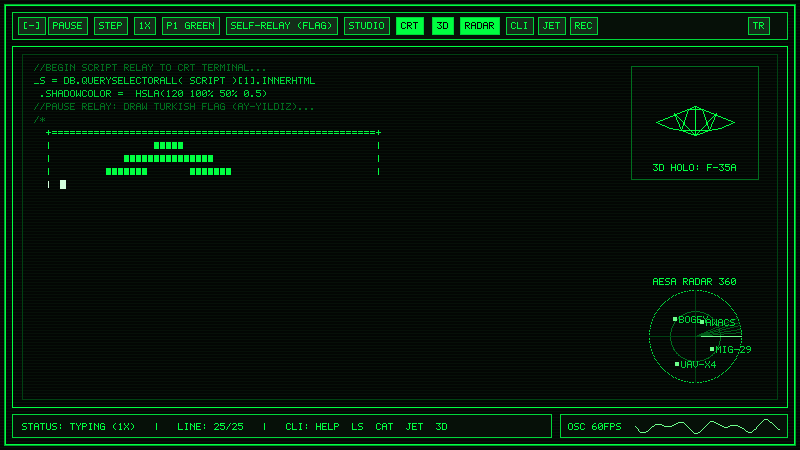

<div align="center">

# 🖥️ Retro CRT Terminal & ASCII Art Studio

[](https://github.com/fmcoskun/retro-crt-terminal-studio/actions/workflows/deploy.yml)


**An interactive 1980s phosphor CRT monitor simulator, self-relaying code quine, 3D wireframe hologram engine, 360° tactical AESA radar, and ASCII Art Studio built with pure HTML5 Canvas and Vanilla JavaScript.**

[🌐 **Live Demo (GitHub Pages)**](https://fmcoskun.github.io/retro-crt-terminal-studio/) · [🇹🇷 **Türkçe Dokümantasyon**](#-türkçe-dokümantasyon) · [🇬🇧 **English Documentation**](#-english-documentation)

---



</div>

---

## 🇬🇧 English Documentation

### ✨ Key Features

| Category | Features |
| :--- | :--- |
| **🖥️ Authentic CRT Physics** | Phosphor persistence trails, white-hot character afterglow, scanline & vignette overlay, magnetic **Degauss** coil distortion, signal **Glitch** RGB split, and dynamic Ambilight bezel glow. |
| **📜 Built-in Scenario Templates** | **1. Self-Relay (Turkish Flag / Ay-Yıldız Quine)**<br>**2. 1989 BIOS Boot Sequence**<br>**3. Cyberpunk Mainframe Intrusion**<br>**4. F-35 Lightning II 3-View Stealth Blueprint & Telemetry**<br>**5. Global Cyber Threat & Satellite Backbone Map** (with live animated Bezier packet arcs) |
| **🌐 3D Wireframe Hologram** | Real-time 3D perspective projection engine rendering rotating **F-35A Stealth Fighter**, **3D Lat/Lon Globe**, and **4D Hypercube (Tesseract)** models (`🌐 3D`). |
| **📡 360° Tactical AESA Radar** | Rotating phosphor sweep sector with target distance rings and live contact blips (`MIG-29`, `UAV-X4`, `BOGEY`, `AWACS`). |
| **🎹 Web Audio & Oscilloscope** | Procedural keystroke synthesizer (*Mechanical Key*, *8-Bit Beep*, *Classic Typewriter*), 125 BPM **Synthwave / Chiptune** sequencer (`🎵 Music`), and real-time `AnalyserNode` frequency oscilloscope. |
| **✎ Custom Code & ASCII Studio** | Live code/text relay editor with automatic responsive word-wrapping, **5-row Block ASCII Banner Generator**, **Image-to-ASCII Converter**, **Live JavaScript Sandbox (`⚡ Run JS`)**, browser storage save (`💾 Save`), and instant default restore (`↺ Reset`). |
| **💻 Interactive CLI & Virtual FS** | Full post-relay command-line interface with a virtual filesystem (`ls`, `cat`), live JS evaluation (`run`, `calc`), brute-force simulator (`hack`), and system controls. |
| **🕹️ Retro CRT Arcade Games** | Built-in **F-35 Tactical Interceptor (`✈️ Jet`)** space-shooter and **Retro CRT Snake (`🐍 Snake`)** playable directly on the phosphor canvas. |
| **🎥 Recording & Sharing** | One-click **PNG Screenshot (`📷 PNG`)**, **60 FPS WebM Video Recorder (`⏺ Rec`)**, and **Base64 URL Hash Permalink (`🔗 Share`)**. |
| **🌍 Bilingual UI (EN / TR)** | Instant switch between **English** and **Turkish (`🇹🇷 TR` / `🇬🇧 EN`)** from the top-right header bar. |

### 💻 Interactive CLI Commands

Once the typing relay finishes (or immediately by clicking **`💻 CLI`**), type commands directly on your keyboard:

```bash
help                                  # List all available terminal commands
ls                                    # List files in the virtual filesystem (/home/guest)
cat turk_bayragi.art                  # Display Turkish Flag ASCII art file
cat f35_specs.dat                     # Display classified F-35A technical dossier
run console.log(2 ** 16)              # Execute live JavaScript in sandbox
calc 1920 * 1080                      # Evaluate mathematical expression
3d <f35|globe|cube|off>               # Switch 3D wireframe hologram model
jet                                   # Launch F-35 Tactical Interceptor arcade game
snake                                 # Launch Retro CRT Snake mini-game
music                                 # Toggle 8-bit Synthwave background sequencer
matrix                                # Toggle Matrix digital rain overlay
theme <green|amber|cyan|synthwave|matrix> # Switch CRT phosphor palette
template <quine|bios|hack|starship|cybermap> # Load scenario template
banner HELLO WORLD                    # Render large block-pixel ASCII banner
hack 192.0.2.99                       # Run animated SSH packet decryption simulation
rec / export / share / clear          # Record video, save PNG, copy permalink, or clear screen
```

### ⌨️ Keyboard Shortcuts

* **`Space`** — Pause / Resume typing (or fire twin AIM-120 missiles in F-35 Jet game)
* **`N`** — Step to the next line immediately
* **`R`** — Restart current script relay from line 1
* **`G`** — Trigger electromagnetic signal glitch
* **`M`** — Toggle keystroke audio synthesizer
* **`Arrow Keys` / `WASD`** — Pilot F-35 fighter or steer Snake (`Esc` to exit game)

---

## 🇹🇷 Türkçe Dokümantasyon

### ✨ Öne Çıkan Özellikler

* **🖥️ Gerçekçi CRT Monitör Fizikleri:** Fosfor iz süresi (persistence), yeni yazılan harflerde akkor parlama (afterglow), tarama çizgileri (scanlines), manyetik **Degauss** dalgalanması, **Glitch** RGB kırılması ve temaya duyarlı Ambilight ekran çerçevesi.
* **📜 5 Hazır Senaryo Şablonu:**
  1. **Self-Relay (Ay-Yıldızlı Türk Bayrağı Quine):** Sayfanın kendi kaynak kodunu ve Türk Bayrağı ASCII sanatını ekrana daktilo eder.
  2. **1989 BIOS Boot:** Nostaljik 80386DX donanım ve bellek kontrol sekansı.
  3. **Cyberpunk Mainframe:** Güvenlik duvarı aşma ve ağ sızma simülasyonu.
  4. **F-35 Savaş Uçağı Telemetrisi:** 3 görünüşlü (üst, ön V-kuyruk, yan) teknik F-35A planı ve aviyonik verileri.
  5. **Küresel Siber Harita:** ★ Ankara Merkez (`ANK-HQ`) odaklı, kıtalararası canlı veri paketi animasyonlu dünya haritası.
* **🌐 3B Tel-Kafes (Wireframe) Hologram Motoru:** Sağ üst köşede gerçek zamanlı dönen **F-35A**, **3B Küre (Globe)** ve **4B Hiperküp (Tesseract)** modelleri (`🌐 3B`).
* **📡 360° Taktik AESA Radar & Osiloskop:** Sağ alt köşede dönen radar taraması ve alt barda gerçek zamanlı Web Audio `AnalyserNode` ses frekans osiloskopu.
* **✎ Özel Kod & ASCII Sanat Stüdyosu:** Otomatik satır kaydırma (word-wrap), **ASCII Banner Üretici**, **Resimden ASCII Dönüştürücü**, **Canlı JS Çalıştırıcı (`⚡ JS Çalıştır`)**, tarayıcı hafızasına kaydetme (`💾 Kaydet`) ve varsayılan kodu geri yükleme (`↺ Sıfırla`).
* **🕹️ Çift Retro Oyun Modu:** Doğrudan CRT ekranında oynanabilen **F-35 Hava Savunma (`✈️ F-35`)** ve **Retro Yılan (`🐍 Snake`)** oyunları.
* **🎥 Kayıt ve Paylaşım:** Tek tıkla **PNG Ekran Görüntüsü**, **WebM Video Kaydı (`⏺ Kayıt`)** ve **Paylaşılabilir URL Permalink (`🔗 Paylaş`)**.

### 🚀 Kurulum ve Çalıştırma

Proje sıfır bağımlılıkla (zero-dependency) geliştirilmiştir. Herhangi bir paket kurulumuna gerek yoktur:

```bash
git clone https://github.com/fmcoskun/retro-crt-terminal-studio.git
cd retro-crt-terminal-studio
```

Ardından [`index.html`](./index.html) dosyasını doğrudan tarayıcınızda açabilir veya yerel bir sunucu ile çalıştırabilirsiniz:

```bash
npx serve .
# veya
python -m http.server 8080
```

### 📂 Proje Yapısı

```text
retro-crt-terminal-studio/
├── .github/workflows/
│   └── deploy.yml     # Otomatik JS sözdizimi kontrolü ve GitHub Pages yayını
├── index.html         # CRT HUD kontrolleri, OSD menüsü, Stüdyo modalı ve Türk Bayrağı Quine
├── style.css          # Tam ekran duyarlı (responsive) CRT çerçevesi, tarama çizgileri ve animasyonlar
├── script.js          # 2B/3B Kanvas motoru, Web Audio sentezleyici, şablonlar, CLI ve oyunlar
├── preview.gif        # Animasyonlu CRT terminal önizleme görseli
└── README.md          # İki dilli (EN/TR) proje dokümantasyonu
```
